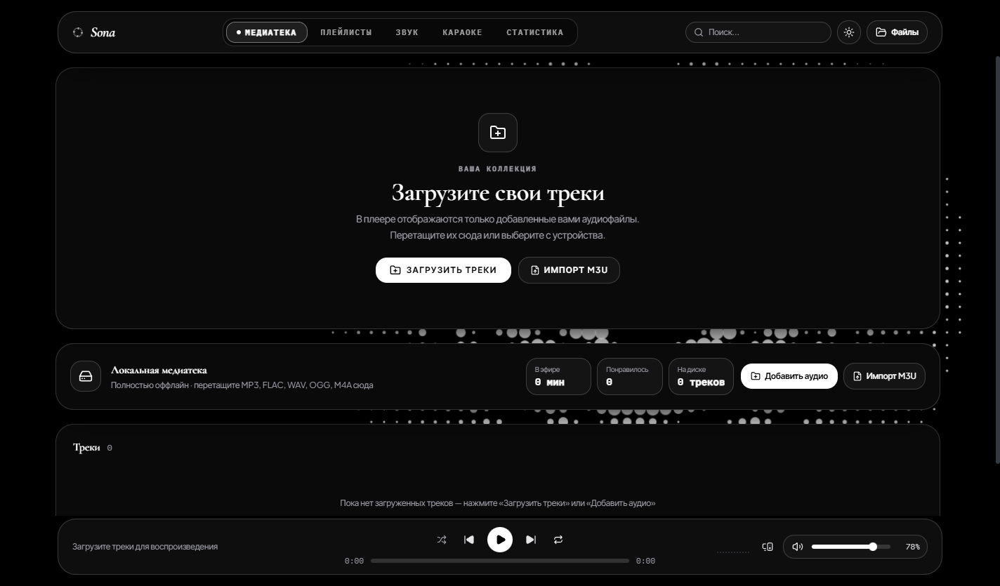
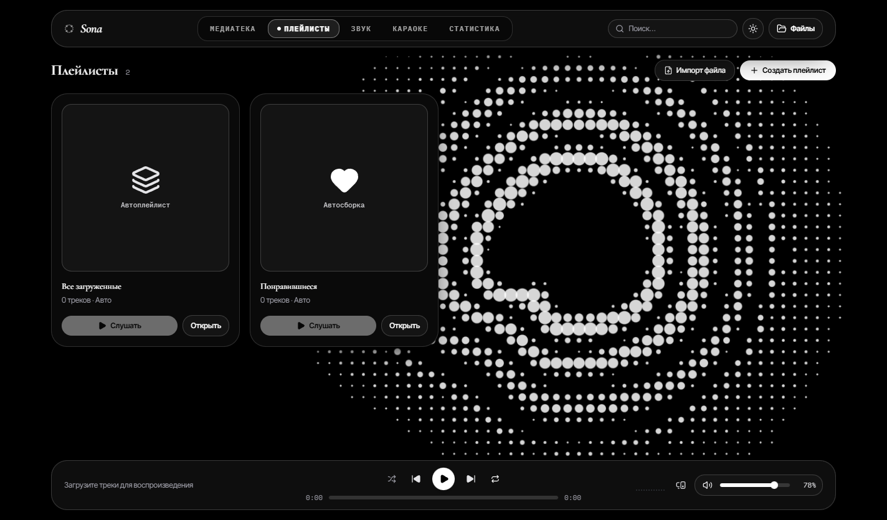
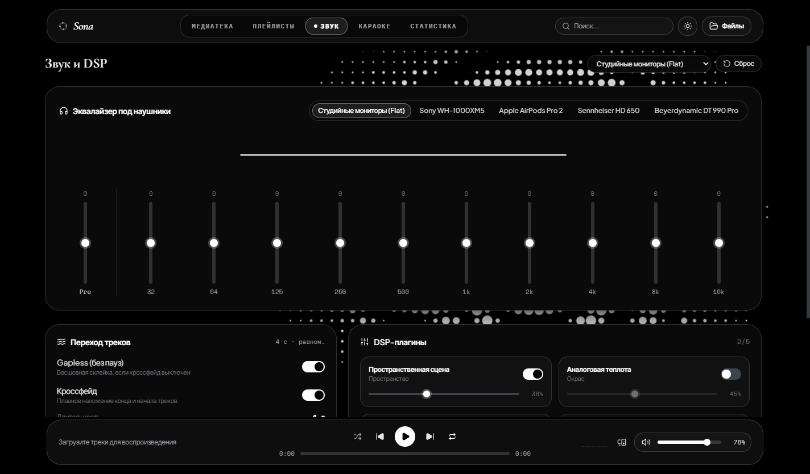
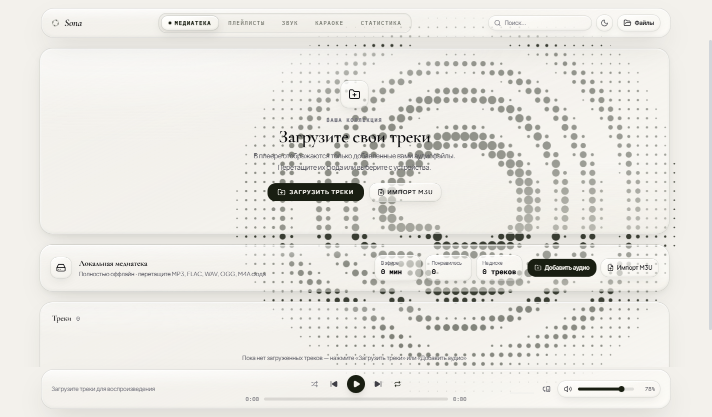
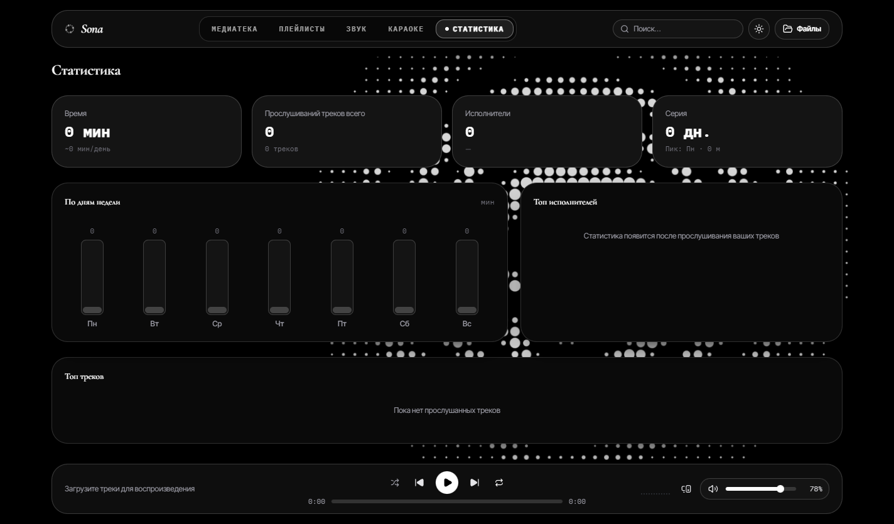

<div align="center">

# 🎧 Sona

**Музыкальный плеер для вашей локальной медиатеки — полностью офлайн**

Windows 10/11 · Electron · React 19 · Vite · Tailwind CSS

[⬇️ Скачать для Windows](../../releases/latest)



</div>

## ✨ Возможности

- 📁 **Локальная медиатека.** Перетащите MP3, FLAC, WAV, OGG или M4A в окно — треки хранятся у вас, без облака и аккаунтов.
- 🏷️ **Чтение ID3-тегов.** Название, исполнитель, альбом и обложка подтягиваются из файлов.
- 📜 **Плейлисты.** Можно создавать свои, импортировать M3U, есть автоплейлисты («Все загруженные», «Понравившиеся»).
- 🎚️ **Эквалайзер и DSP.** 10-полосный EQ с пресетами под популярные наушники (Sony WH-1000XM5, AirPods Pro 2, HD 650, DT 990 Pro…), плюс DSP-плагины: пространственная сцена, аналоговая теплота и другие.
- 🔀 **Gapless и кроссфейд.** Треки переходят друг в друга без пауз.
- 🎤 **Караоке-режим.** Текст песни на весь экран.
- 📊 **Статистика прослушиваний.**
- 🌗 **Тёмная и светлая темы** с живым анимированным фоном.

## 📸 Скриншоты

| Плейлисты | Звук и DSP |
|---|---|
|  |  |

| Светлая тема | Статистика |
|---|---|
|  |  |

## ⬇️ Установка

1. Откройте [Releases](../../releases/latest) и скачайте `Sona-Setup-x.x.x-win-x64.exe`.
2. Запустите установщик и выберите папку для установки.
3. Ярлыки появятся на рабочем столе и в меню «Пуск».

> Установщик не подписан цифровой подписью, поэтому Windows SmartScreen может показать предупреждение. Нажмите **«Подробнее» → «Выполнить в любом случае»**.

## 🛠️ Разработка

Нужен [Node.js](https://nodejs.org/) 22+.

```bash
npm install
npm run dev        # запуск в режиме разработки на http://localhost:3000
npm run dist:win   # сборка установщика Windows → папка release/
```

Чтобы работал поиск метаданных через Gemini, создайте `.env.local` с ключом `GEMINI_API_KEY` (пример — в `.env.example`).

## 📦 Стек

- **UI:** React 19, Tailwind CSS 4, Motion, Lucide
- **Сборка:** Vite, esbuild
- **Десктоп:** Electron, electron-builder (NSIS)
- **Сервер:** Express (встроен в приложение)
- **Аудио:** Web Audio API (EQ, DSP, кроссфейд)
- **Хранилище:** IndexedDB (треки хранятся офлайн)
